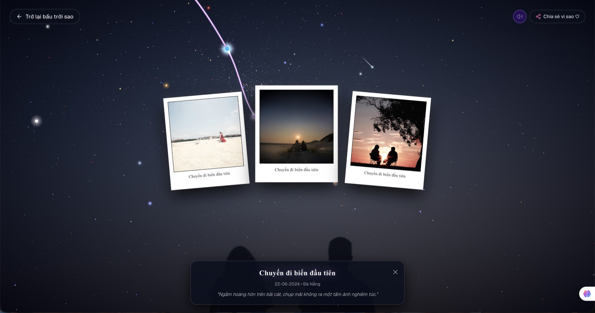
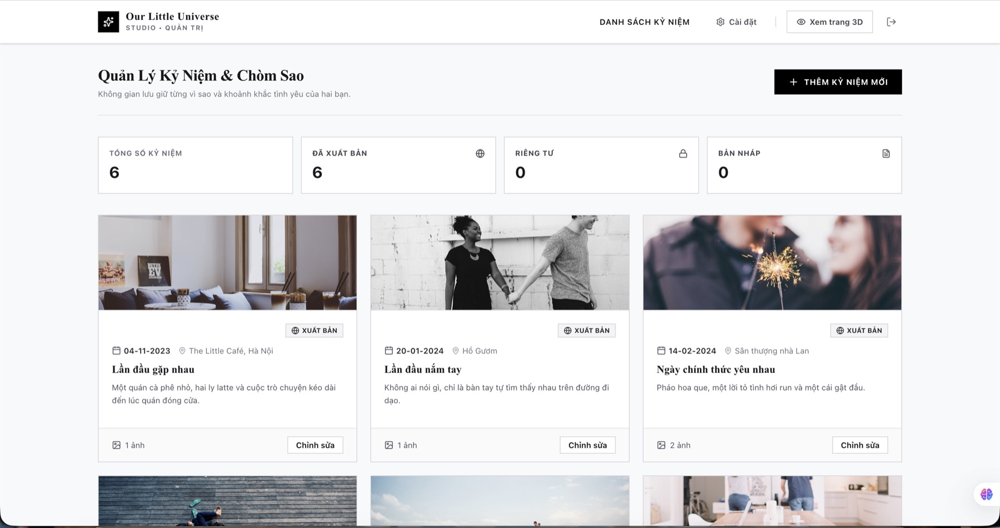

# Memories — Our Little Universe

Website lưu giữ kỷ niệm của hai người dưới dạng một bầu trời sao 3D. Mỗi kỷ niệm là một ngôi sao, gồm tiêu đề, ngày, địa điểm, lời nhắn và bộ ảnh. Khách xem trang không cần đăng nhập. Chủ không gian (và tối đa một người cùng chỉnh sửa) quản lý nội dung trong trang Studio.

Repo có sẵn dữ liệu mẫu của một cặp đôi hư cấu (Minh và Lan), nên clone về là chạy và xem được ngay, không cần tạo tài khoản dịch vụ nào.

## Ảnh ứng dụng

Bầu trời sao kỷ niệm (trang chủ):


Xem chi tiết một kỷ niệm:



Trang quản trị Studio:



## Tính năng

- Trang chủ `/`: bầu trời sao 3D, mỗi kỷ niệm là một ngôi sao nối với nhau theo thời gian, có bộ đếm số ngày bên nhau và nhạc nền.
- Bấm vào một ngôi sao để xem ảnh dạng polaroid kèm ngày, địa điểm và lời nhắn.
- `/story`: dòng thời gian theo năm, có bộ lọc theo năm.
- `/milestones`: các cột mốc quan trọng.
- Studio `/studio`: thêm, sửa, xoá kỷ niệm; upload và sắp xếp nhiều ảnh; chọn trạng thái Xuất bản, Riêng tư hoặc Bản nháp; đổi tên hiển thị, tiêu đề, ngày bắt đầu, nhạc nền.
- Mời người thứ hai cùng chỉnh sửa bằng link dùng một lần, hết hạn sau 7 ngày.
- Giao diện tối ưu cho điện thoại.

## Công nghệ

Next.js 16 (App Router), React 19, TypeScript, Tailwind CSS 4, Three.js, Supabase (Postgres, Auth, Storage), Zod, Vitest.

---

## Chạy dự án trên máy

### Bước 1. Cài Node.js và Git

Cần **Node.js bản 20.9 trở lên** (khuyên dùng bản LTS mới nhất) và **Git**. Nếu máy đã có thì bỏ qua bước này. Kiểm tra bằng:

```bash
node -v
git --version
```

#### Windows

Cách 1, dùng `winget` (có sẵn trên Windows 10/11). Mở **PowerShell** và chạy:

```powershell
winget install OpenJS.NodeJS.LTS
winget install Git.Git
```

Cách 2: tải bộ cài Node.js LTS tại https://nodejs.org và Git tại https://git-scm.com/download/win, rồi bấm Next đến hết.

Sau khi cài xong, **đóng PowerShell và mở lại** để nhận lệnh `node`, `npm`, `git`.

#### macOS

Nếu đã có Homebrew (https://brew.sh):

```bash
brew install node git
```

Nếu chưa có Homebrew, tải bộ cài Node.js LTS (file `.pkg`) tại https://nodejs.org. Git sẽ được macOS đề nghị cài (Command Line Tools) ở lần đầu bạn gõ `git`.

#### Linux (Ubuntu / Debian)

Kho mặc định của Ubuntu thường có Node.js quá cũ, nên cài qua NodeSource:

```bash
sudo apt update
sudo apt install -y curl git
curl -fsSL https://deb.nodesource.com/setup_22.x | sudo -E bash -
sudo apt install -y nodejs
```

Các bản phân phối khác (Fedora, Arch...) có thể dùng `nvm` (https://github.com/nvm-sh/nvm), cách này dùng được cho cả Linux lẫn macOS:

```bash
nvm install --lts
nvm use --lts
```

### Bước 2. Tải mã nguồn

```bash
git clone https://github.com/LionelHuanSi/memories.git
cd memories
```

### Bước 3. Cài thư viện

```bash
npm install
```

Lần đầu mất khoảng 1 đến 3 phút tuỳ tốc độ mạng.

### Bước 4. Tạo file cấu hình `.env.local`

Sao chép file mẫu `.env.example` thành `.env.local`. **Giữ nguyên nội dung**: giá trị mặc định trong đó bật chế độ chạy thử, không cần Supabase.

macOS / Linux:

```bash
cp .env.example .env.local
```

Windows (PowerShell):

```powershell
Copy-Item .env.example .env.local
```

Windows (Command Prompt):

```bat
copy .env.example .env.local
```

### Bước 5. Chạy

```bash
npm run dev
```

Khi terminal hiện dòng `Ready`, mở trình duyệt vào http://localhost:3000. Bạn sẽ thấy bầu trời sao với 9 kỷ niệm mẫu.

Muốn dừng server, quay lại terminal và bấm `Ctrl + C`.

### Bước 6. Đăng nhập Studio

Mở http://localhost:3000/login và đăng nhập bằng:

| Tài khoản | Mật khẩu |
|---|---|
| `demo` | `demo1234` |

Sau khi đăng nhập, bạn có thể thêm kỷ niệm, upload ảnh, đổi tên hiển thị và nhạc nền trong mục Cài đặt.

---

## Dữ liệu khi chạy trên máy được lưu ở đâu

Ở chế độ chạy thử, app không dùng database thật:

- Kỷ niệm, tài khoản, cài đặt: lưu trong file `data/local_store.json`.
- Ảnh và nhạc bạn upload: lưu trong thư mục `public/uploads/`. Thư mục này đã nằm trong `.gitignore` nên không bị đẩy lên Git.

Đổi tài khoản hoặc mật khẩu: sửa mục `users` trong `data/local_store.json`, rồi khởi động lại server.

### Đưa dữ liệu về như ban đầu

macOS / Linux:

```bash
git checkout -- data/local_store.json
rm -rf public/uploads
```

Windows (PowerShell):

```powershell
git checkout -- data/local_store.json
Remove-Item -Recurse -Force public/uploads
```

---

## Chạy trên máy với Supabase của riêng bạn (không bắt buộc)

Làm phần này khi bạn muốn dùng database thật thay cho file JSON.

1. Tạo một project miễn phí tại https://supabase.com.
2. Trong project, mở **SQL Editor** và chạy lần lượt nội dung các file sau (mỗi file một lần, theo đúng thứ tự):
   1. `supabase/migrations/20261013000001_initial_schema.sql`
   2. `supabase/migrations/20261013000002_rls_policies.sql`
   3. `supabase/migrations/20261013000003_storage_policies.sql`
   4. `supabase/seed.sql` (dữ liệu mẫu, có thể bỏ qua)
3. Vào **Project Settings > API Keys**, lấy Project URL, `anon` key và `service_role` key, rồi điền vào `.env.local`:

   ```env
   NEXT_PUBLIC_SUPABASE_URL=https://<project-ref>.supabase.co
   NEXT_PUBLIC_SUPABASE_ANON_KEY=<anon-key>
   SUPABASE_SERVICE_ROLE_KEY=<service-role-key>
   NEXT_PUBLIC_APP_URL=http://localhost:3000
   BOOTSTRAP_SECRET=<chuoi-ngau-nhien-bat-ky>
   DEFAULT_SPACE_SLUG=our-universe
   DEFAULT_SPACE_TITLE="Our Little Universe"
   ```

   `service_role` key có toàn quyền với database. Không chia sẻ và không commit file `.env.local`.

4. Tạo tài khoản chủ không gian:

   ```bash
   node scripts/bootstrap.mjs email-cua-ban@gmail.com MatKhauCuaBan123
   ```

5. Chạy `npm run dev` rồi đăng nhập tại http://localhost:3000/login bằng **đầy đủ email** và mật khẩu vừa tạo.

### Biến môi trường

| Biến | Ý nghĩa |
|---|---|
| `NEXT_PUBLIC_SUPABASE_URL` | URL Supabase. Nếu chứa `dummy-project` thì app chạy ở chế độ chạy thử (dùng `data/local_store.json`) |
| `NEXT_PUBLIC_SUPABASE_ANON_KEY` | Anon key của Supabase |
| `SUPABASE_SERVICE_ROLE_KEY` | Service role key, chỉ dùng phía server |
| `NEXT_PUBLIC_APP_URL` | Địa chỉ gốc của app, dùng để tạo link mời |
| `BOOTSTRAP_SECRET` | Mã bí mật cho API `POST /api/bootstrap` |
| `DEFAULT_SPACE_SLUG` | Slug không gian mặc định, để `our-universe` |
| `DEFAULT_SPACE_TITLE` | Tiêu đề không gian khi chạy bootstrap |

---

## Các lệnh có sẵn

| Lệnh | Tác dụng |
|---|---|
| `npm run dev` | Chạy server phát triển tại http://localhost:3000 |
| `npm run build` | Build bản production |
| `npm run start` | Chạy bản đã build (sau `npm run build`) |
| `npm test` | Chạy bộ test |
| `npm run typecheck` | Kiểm tra kiểu TypeScript |
| `npm run lint` | Kiểm tra quy chuẩn code |

## Cấu trúc thư mục

```text
src/
  app/                  Các trang và API: /, /story, /milestones, /login, /studio, /invite, /api
  components/public/    Bầu trời sao 3D, dòng thời gian, xem ảnh
  components/studio/    Form kỷ niệm, quản lý ảnh
  lib/supabase/         Kết nối Supabase và local-mock.ts (chế độ chạy thử)
  lib/validations/      Kiểm tra dữ liệu đầu vào
  middleware.ts         Bảo vệ các trang /studio
supabase/
  migrations/           Cấu trúc database và phân quyền
  seed.sql              Dữ liệu mẫu cho Supabase
data/local_store.json   Dữ liệu của chế độ chạy thử
public/demo/couple/     Ảnh mẫu
scripts/bootstrap.mjs   Tạo tài khoản chủ không gian trên Supabase
tests/                  Bộ test
```

## Tuỳ biến nhanh

- Tên hiển thị, tiêu đề, ngày bắt đầu, nhạc nền: Studio > Cài đặt.
- Ảnh nền bầu trời sao: thay file `public/wallpaper.jpg`.
- Ảnh hiển thị khi một ảnh bị lỗi: thay file `public/fallback-photo.jpg`.

## Lỗi thường gặp

**`node` hoặc `npm` không được nhận diện (Windows)**
Đóng hẳn PowerShell hoặc Command Prompt rồi mở lại sau khi cài Node.js. Nếu vẫn lỗi, khởi động lại máy.

**PowerShell báo "running scripts is disabled on this system"**
Chạy lệnh sau một lần rồi thử lại:

```powershell
Set-ExecutionPolicy -Scope CurrentUser RemoteSigned
```

Hoặc dùng Command Prompt (`cmd`) thay cho PowerShell.

**Cổng 3000 đã bị dùng**
Chạy ở cổng khác, ví dụ 3001:

```bash
npm run dev -- -p 3001
```

**Báo lỗi phiên bản Node**
Kiểm tra `node -v`. Nếu thấp hơn 20.9 thì cài lại Node.js bản LTS theo Bước 1.

**Đăng nhập báo sai tài khoản hoặc mật khẩu**
Kiểm tra `.env.local` có đúng nội dung của `.env.example` không. Nếu đã sửa `data/local_store.json`, đưa nó về như ban đầu theo hướng dẫn ở phần trên.

**Bầu trời sao không hiện hoặc màn hình đen**
Trang chủ cần WebGL. Dùng bản mới của Chrome, Edge, Firefox hoặc Safari và bật tăng tốc phần cứng trong cài đặt trình duyệt.

## Tài liệu thêm

- Đặc tả chức năng: [MEMORIES_SRS.md](MEMORIES_SRS.md)
- Các quyết định kiến trúc: [DECISIONS.md](DECISIONS.md)
