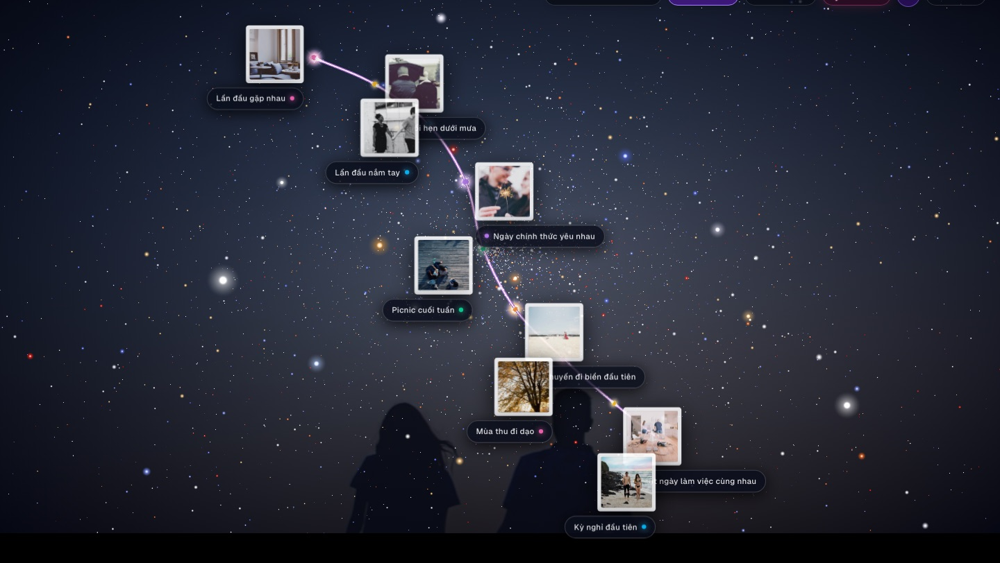
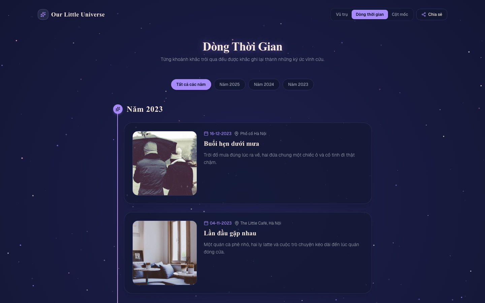
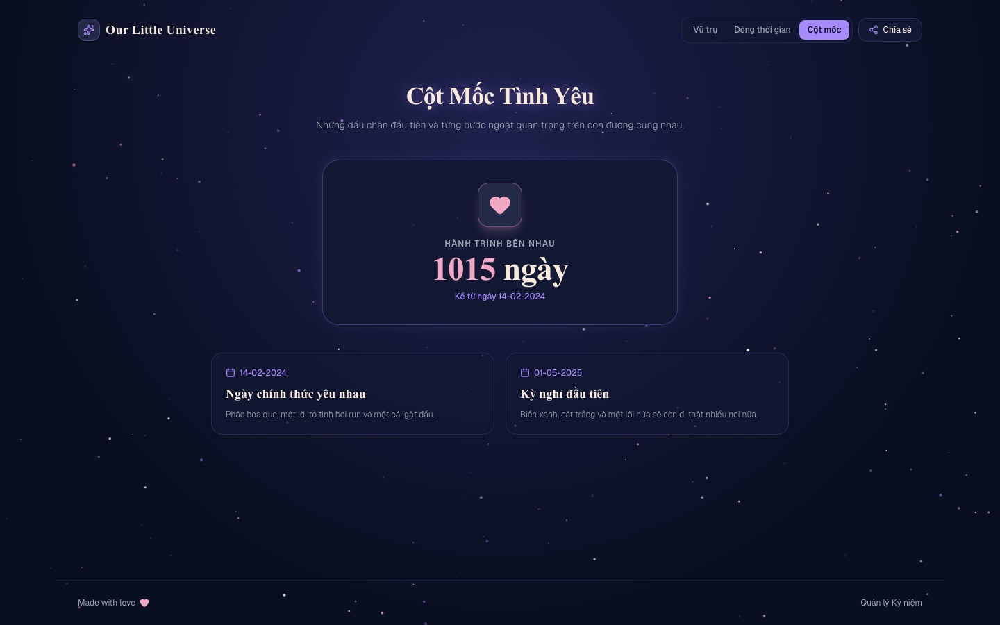
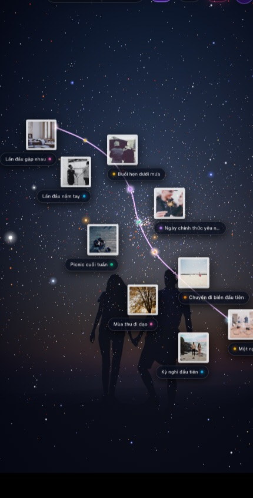

# Memories — Our Little Universe 🌌

Website lưu giữ kỷ niệm dưới dạng **thiên hà 3D** và **dòng thời gian**. Mỗi kỷ niệm là một ngôi sao: có tiêu đề, ngày, địa điểm và bộ ảnh. Khách xem trang công khai không cần đăng nhập; chủ không gian (và tối đa một người cùng chỉnh sửa) quản lý nội dung trong trang **Studio**.

Repo kèm sẵn **dữ liệu mẫu** của một cặp đôi hư cấu (Minh ♡ Lan) để chạy thử ngay.

## 📸 Ảnh ứng dụng



| Dòng thời gian `/story` | Cột mốc `/milestones` | Điện thoại |
|---|---|---|
|  |  |  |

---

## ✨ Tính năng

- **Trang chủ `/`**: thiên hà 3D (Three.js) với mỗi kỷ niệm là một ngôi sao, có bộ đếm ngày, xem ảnh dạng lightbox.
- **`/story`**: dòng thời gian theo năm, lọc nhanh.
- **`/milestones`**: danh sách các cột mốc.
- **Studio `/studio`**: tạo / sửa / xoá kỷ niệm, upload nhiều ảnh, sắp xếp ảnh, chọn trạng thái `draft` / `private` / `published`, cài đặt tiêu đề, tagline, ngày bắt đầu, nhạc nền.
- **Mời người cùng chỉnh sửa**: link mời dùng 1 lần, hết hạn sau 7 ngày (tối đa 2 thành viên mỗi không gian).
- Tối ưu cho điện thoại (safe-area iOS, cử chỉ vuốt trong lightbox, bottom sheet).

## 🛠️ Công nghệ

Next.js 16.4.6 (App Router, Turbopack) · React 19 · TypeScript · Tailwind CSS 4 · Three.js · `@xyflow/react` · Supabase (Postgres, Auth, Storage) · Zod · Vitest

---

## 🚀 Chạy dự án

### Yêu cầu

- **Node.js ≥ 20.9** (khuyến nghị Node 22 LTS trở lên) và npm
- Git

### Cách 1 — Chạy nhanh với dữ liệu demo (không cần Supabase)

Dự án có sẵn **chế độ local mock**: khi `NEXT_PUBLIC_SUPABASE_URL` chứa `dummy-project`, toàn bộ dữ liệu được đọc/ghi vào file `data/local_store.json` và ảnh upload được lưu vào `public/uploads/`.

```bash
git clone https://github.com/LionelHuanSi/memories.git
cd memories
npm install
cp .env.example .env.local   # giữ nguyên giá trị mặc định
npm run dev
```

Mở <http://localhost:3000>.

Đăng nhập Studio tại <http://localhost:3000/login>:

| Tài khoản | Mật khẩu |
|---|---|
| `demo` | `demo1234` |

> Tài khoản này chỉ tồn tại trong `data/local_store.json` để thử nghiệm local. Muốn đổi, sửa trực tiếp mục `users` trong file đó.

**Khôi phục dữ liệu demo** sau khi đã thêm/sửa thử:

```bash
git checkout -- data/local_store.json
rm -rf public/uploads
```

### Cách 2 — Chạy với Supabase thật

1. Tạo một project trên [Supabase](https://supabase.com).
2. Mở **SQL Editor** và chạy lần lượt các file:
   1. `supabase/migrations/20261013000001_initial_schema.sql` — bảng, enum, trigger giới hạn 2 thành viên
   2. `supabase/migrations/20261013000002_rls_policies.sql` — Row Level Security, hàm nhận lời mời
   3. `supabase/migrations/20261013000003_storage_policies.sql` — bucket `memories-media` và policy
   4. *(tuỳ chọn)* `supabase/seed.sql` — nạp dữ liệu mẫu
3. Tạo `.env.local` từ mẫu và điền thông tin trong **Project Settings → API**:

   ```env
   NEXT_PUBLIC_SUPABASE_URL=https://<project-ref>.supabase.co
   NEXT_PUBLIC_SUPABASE_ANON_KEY=<anon-key>
   SUPABASE_SERVICE_ROLE_KEY=<service-role-key>   # chỉ dùng phía server, không commit
   NEXT_PUBLIC_APP_URL=http://localhost:3000
   BOOTSTRAP_SECRET=<chuỗi-ngẫu-nhiên>
   DEFAULT_SPACE_SLUG=our-universe
   DEFAULT_SPACE_TITLE="Our Little Universe"
   ```

4. Tạo tài khoản chủ không gian (owner):

   ```bash
   node scripts/bootstrap.mjs owner@example.com <mat-khau-manh>
   ```

   Script tạo không gian (nếu chưa có), tạo user trong Supabase Auth và gán quyền `owner`.

5. Chạy `npm run dev`, đăng nhập tại `/login` bằng email/mật khẩu vừa tạo.

### Biến môi trường

| Biến | Bắt buộc | Mô tả |
|---|---|---|
| `NEXT_PUBLIC_SUPABASE_URL` | ✅ | URL Supabase. Chứa `dummy-project` ⇒ bật chế độ local mock |
| `NEXT_PUBLIC_SUPABASE_ANON_KEY` | ✅ | Anon key |
| `SUPABASE_SERVICE_ROLE_KEY` | ✅ | Service role key (server-only) |
| `NEXT_PUBLIC_APP_URL` | ✅ | URL gốc của app, dùng để tạo link mời |
| `BOOTSTRAP_SECRET` | | Secret cho `POST /api/bootstrap` |
| `DEFAULT_SPACE_SLUG` | | Slug không gian mặc định (`our-universe`) |
| `DEFAULT_SPACE_TITLE` | | Tiêu đề không gian khi bootstrap |

---

## 🧪 Lệnh hữu ích

```bash
npm run dev        # server phát triển (http://localhost:3000)
npm run build      # build production
npm run start      # chạy bản đã build
npm test           # chạy test Vitest
npm run typecheck  # kiểm tra kiểu TypeScript
npm run lint       # ESLint
```

## 📁 Cấu trúc thư mục

```text
src/
  app/                  # Route (App Router): /, /story, /milestones, /login, /studio, /invite, /api
  components/public/    # Thiên hà 3D, timeline, lightbox, header
  components/studio/    # Form kỷ niệm, quản lý ảnh
  lib/supabase/         # Client Supabase + local-mock.ts (chế độ không cần Supabase)
  lib/validations/      # Schema Zod
  middleware.ts         # Bảo vệ /studio
supabase/
  migrations/           # Schema, RLS, storage policy
  seed.sql              # Dữ liệu mẫu cho Supabase
data/local_store.json   # "Database" của chế độ local mock
public/demo/couple/     # Ảnh mẫu
scripts/bootstrap.mjs   # Tạo owner đầu tiên trên Supabase
tests/                  # Test Vitest
```

## 🎨 Tuỳ biến nhanh

- **Tên hiển thị, tiêu đề, tagline, ngày bắt đầu, nhạc nền**: chỉnh trong Studio → **Cài đặt**, hoặc sửa mục `spaces` trong `data/local_store.json`.
- **Hình nền thiên hà**: thay file `public/wallpaper.jpg` (hoặc sửa `backgroundImage` trong `STARFIELD_CONFIG` ở `src/components/public/CosmicGalaxy3D.tsx`).
- **Ảnh dự phòng** khi ảnh lỗi: `public/fallback-photo.jpg`.

Tài liệu thiết kế chi tiết: [MEMORIES_SRS.md](MEMORIES_SRS.md) · Quyết định kiến trúc: [DECISIONS.md](DECISIONS.md)
